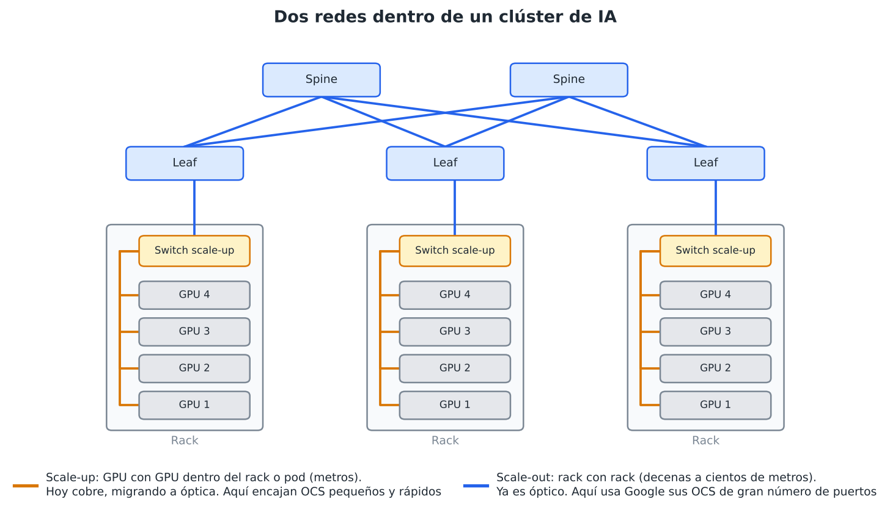
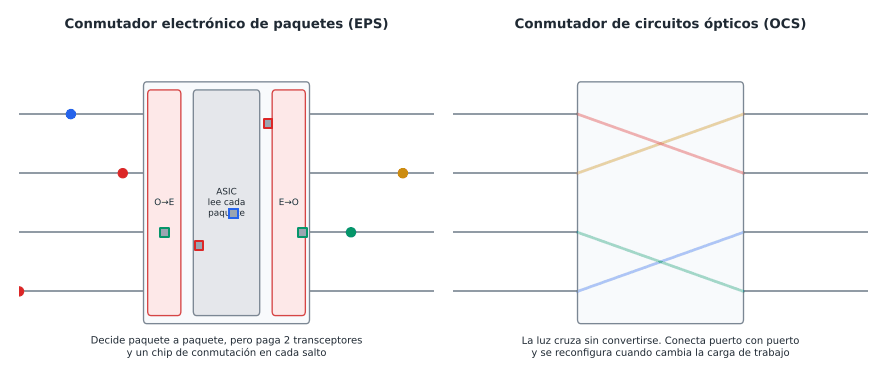
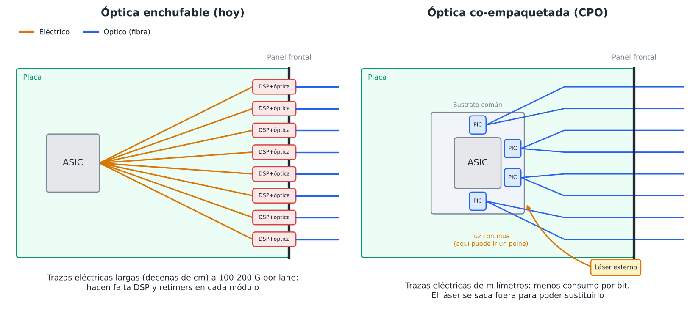
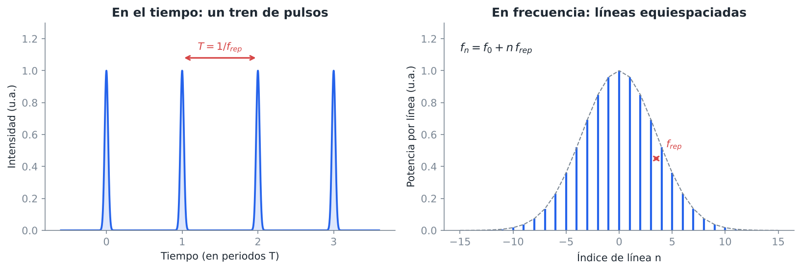
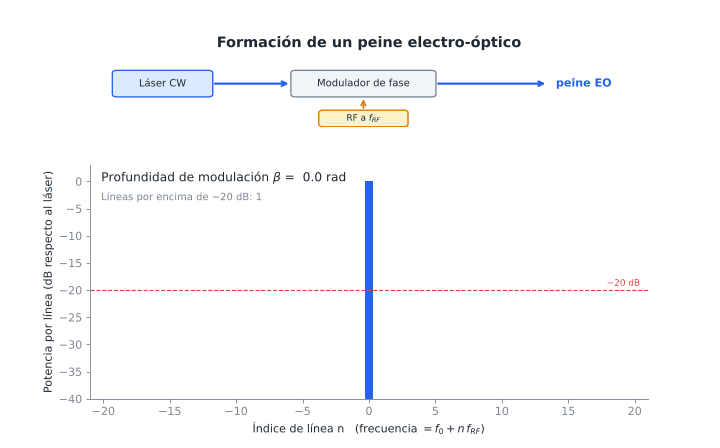
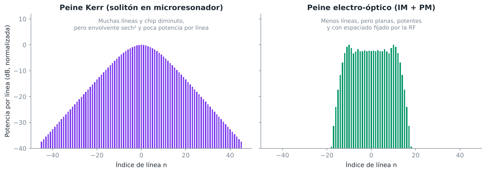
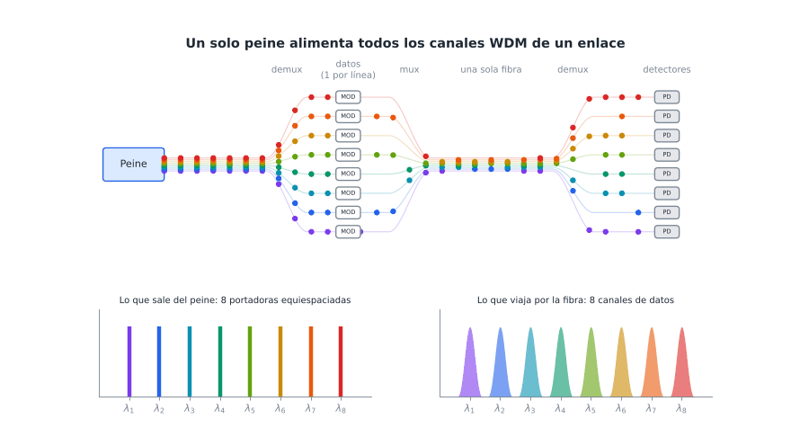
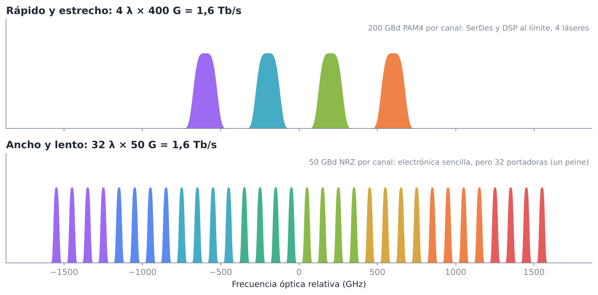
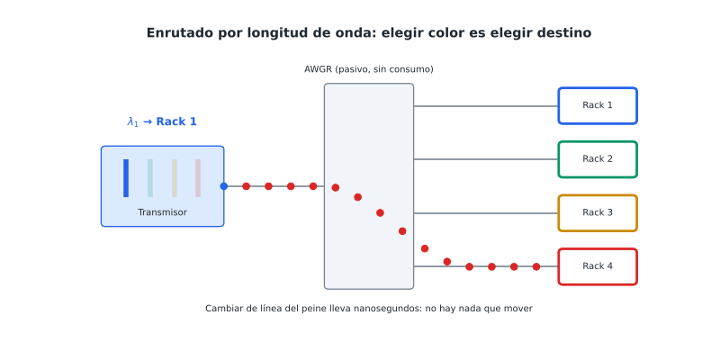
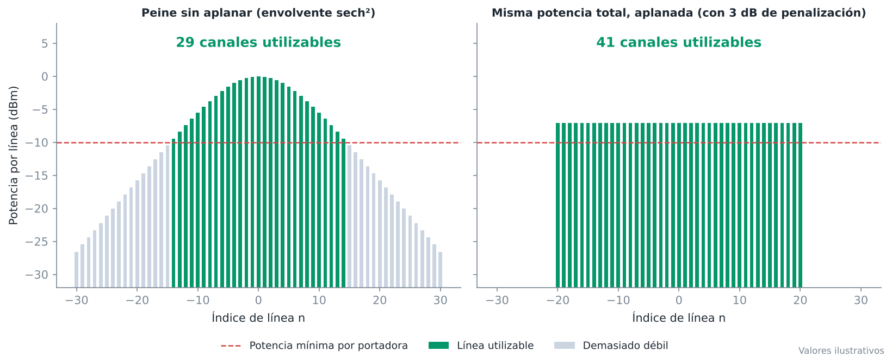

# AI interconnects y peines de frecuencia ópticos

Una explicación visual de cómo se conectan entre sí los chips de un clúster de inteligencia artificial, por qué esa red se está volviendo óptica y qué pueden aportar los peines de frecuencia ópticos (OFC, *optical frequency combs*).

Todas las figuras y animaciones se generan con Python (numpy + matplotlib) a partir del código de `src/`, así que se pueden modificar y regenerar.

## Índice

1. [El problema: la red es el cuello de botella](#1-el-problema-la-red-es-el-cuello-de-botella)
2. [Conmutar electrones o conmutar luz: EPS frente a OCS](#2-conmutar-electrones-o-conmutar-luz-eps-frente-a-ocs)
3. [Acercar la óptica al chip: enchufables frente a CPO](#3-acercar-la-óptica-al-chip-enchufables-frente-a-cpo)
4. [Qué es un peine de frecuencia](#4-qué-es-un-peine-de-frecuencia)
5. [Cómo se genera: peines EO y peines Kerr](#5-cómo-se-genera-peines-eo-y-peines-kerr)
6. [Uso 1: una sola fuente para todos los canales WDM](#6-uso-1-una-sola-fuente-para-todos-los-canales-wdm)
7. [Uso 2: muchos canales lentos en vez de pocos rápidos](#7-uso-2-muchos-canales-lentos-en-vez-de-pocos-rápidos)
8. [Uso 3: conmutar eligiendo color](#8-uso-3-conmutar-eligiendo-color)
9. [Uso 4: detección coherente sin láser local](#9-uso-4-detección-coherente-sin-láser-local)
10. [El reto: planitud y potencia por línea](#10-el-reto-planitud-y-potencia-por-línea)
11. [Cómo regenerar las figuras](#cómo-regenerar-las-figuras)
12. [Referencias](#referencias)

---

## 1. El problema: la red es el cuello de botella

Entrenar o servir un modelo grande no lo hace una GPU, sino miles trabajando como una sola máquina. Eso solo funciona si pueden intercambiar datos a enorme velocidad. En un clúster hay en realidad dos redes distintas:



- **Scale-up**: une las GPUs dentro de un rack o de un pod para que se comporten como un único ordenador. Distancias de metros. Hoy es sobre todo cobre, pero el cobre se queda sin alcance al subir la velocidad, y esta red está empezando a pasar a óptica.
- **Scale-out**: une racks entre sí mediante conmutadores (*leaf* y *spine*). Distancias de decenas a cientos de metros. Ya es óptica.

Las dos crecen con el tamaño de los modelos, y las dos están limitadas por lo mismo: **cuántos bits por segundo caben por cada fibra y por cada milímetro del borde del chip, y cuánta energía cuesta cada bit**.

## 2. Conmutar electrones o conmutar luz: EPS frente a OCS



**A la izquierda**, un conmutador electrónico de paquetes (EPS). La luz llega por la fibra, se convierte a señal eléctrica, un chip lee la cabecera de cada paquete (el color indica su destino), decide por dónde sale y se vuelve a convertir en luz. Es muy flexible, porque decide paquete a paquete, pero cada salto cuesta dos transceptores, un chip de conmutación y latencia.

**A la derecha**, un conmutador de circuitos ópticos (OCS, *optical circuit switch*). No lee nada: conecta físicamente cada puerto de entrada con uno de salida y la luz cruza sin convertirse. Es transparente a la velocidad y al formato de los datos, y consume muy poco. A cambio, no puede decidir paquete a paquete: establece circuitos y los cambia cuando cambia la carga de trabajo (la pausa de "reconfigurando" en la animación).

Los OCS se construyen con tecnologías muy distintas: microespejos MEMS (cientos de puertos, milisegundos), cristal líquido, piezoeléctricos, o fotónica de silicio (menos puertos, microsegundos). Los primeros dominan hoy en scale-out; los segundos apuntan al scale-up.

## 3. Acercar la óptica al chip: enchufables frente a CPO



Hoy la conversión entre electrones y luz se hace en módulos enchufables en el panel frontal. La señal eléctrica tiene que recorrer decenas de centímetros de placa a 100 o 200 Gb/s por línea, y para sobrevivir a ese trayecto cada módulo necesita un DSP que consume mucho.

En la óptica co-empaquetada (CPO), los chips fotónicos (PIC) se montan junto al ASIC, sobre el mismo sustrato. Las trazas eléctricas pasan a medir milímetros y el consumo por bit baja de forma notable (como orden de magnitud, el sector habla de pasar de unos 15 a 20 pJ/bit a unos 5 pJ/bit).

Hay un detalle importante para lo que sigue: en CPO **el láser se saca fuera del encapsulado**, porque es el componente que más falla y el que peor lleva el calor. La luz continua entra por fibra desde una fuente externa. Esa fuente externa es exactamente el sitio donde puede ir un peine.

## 4. Qué es un peine de frecuencia



Un peine de frecuencia es una fuente de luz cuyo espectro son muchas líneas estrechas y **exactamente equiespaciadas**: `f_n = f_0 + n·f_rep`. En el tiempo equivale a un tren de pulsos que se repite cada `T = 1/f_rep`. Son dos formas de ver lo mismo.

Para comunicaciones, lo que importa de un peine es:

- **Muchas portadoras desde una sola fuente.**
- **Espaciado fijo por construcción.** Las líneas no se mueven unas respecto a otras, cosa que no se puede decir de N láseres independientes.
- **Coherencia mutua.** Todas las líneas comparten fase.

## 5. Cómo se genera: peines EO y peines Kerr

### Peine electro-óptico (EO)



Se parte de un láser continuo y se le modula la fase con una señal de radiofrecuencia. El campo es `E(t) = exp(i·β·sin(2π·f_RF·t))` y su espectro tiene líneas en `f_0 + n·f_RF` con potencia `J_n(β)²` (funciones de Bessel). Al aumentar la profundidad de modulación `β`, la potencia de la portadora se reparte entre más líneas: el número de líneas útiles crece como `2β`, aproximadamente.

La animación también enseña el problema: con solo modulación de fase **el espectro no es plano**, algunas líneas casi desaparecen. Por eso en la práctica se añade un modulador de intensidad, o etapas no lineales posteriores, para aplanar y ensanchar.

### Peine Kerr (microresonador)

Un láser continuo bombea un microanillo de nitruro de silicio. El efecto Kerr genera líneas nuevas en las resonancias del anillo y, en el régimen adecuado, se forma un solitón que da un peine estable con el espaciado del anillo (su FSR).

### Comparación



| | Peine Kerr | Peine EO |
|---|---|---|
| Número de líneas | Muy alto (decenas a cientos) | Moderado (decenas) |
| Forma del espectro | Envolvente sech², cae hacia los bordes | Bastante plana |
| Potencia por línea | Baja (eficiencia de conversión limitada) | Alta |
| Espaciado | Fijado por el anillo | Fijado por la RF, sintonizable |
| Tamaño | Chip diminuto | Moduladores y electrónica de RF |

Formas ilustrativas, calculadas con modelos sencillos, no datos medidos.

## 6. Uso 1: una sola fuente para todos los canales WDM



La forma más directa de meter más datos por una fibra es usar varias longitudes de onda a la vez (WDM). El método clásico necesita un láser por canal, cada uno con su control de temperatura para que no se salga de su sitio.

Con un peine, una sola fuente da todas las portadoras. Se separan las líneas, cada una pasa por su modulador (que imprime los datos: en la animación, un punto que desaparece es un 0), se vuelven a juntar y viajan por una única fibra. En el otro extremo se separan otra vez y cada color va a su fotodetector.

Ventajas frente a N láseres:

- Un solo dispositivo que estabilizar en lugar de N.
- El espaciado entre canales no deriva, así que se pueden juntar más.
- Encaja con CPO: el peine sustituye al láser externo.

## 7. Uso 2: muchos canales lentos en vez de pocos rápidos



Hay dos maneras de llegar a 1,6 Tb/s por fibra. La de arriba exprime cada canal: pocos canales muy rápidos, con modulación multinivel (PAM4) y DSP cada vez más caros en energía. La de abajo usa muchos canales a velocidad moderada con modulación simple (NRZ) y electrónica sencilla, que consume menos por bit.

La segunda estrategia ocupa más espectro y necesita muchas portadoras. Con láseres discretos no es práctica. Con un peine, sí.

## 8. Uso 3: conmutar eligiendo color



Aquí es donde los peines se cruzan con la conmutación óptica. Un AWGR (*arrayed waveguide grating router*) es un componente pasivo: cada longitud de onda que entra por un puerto sale por un puerto distinto. Si cada rack destino tiene asignado un color, **enviar a un destino es elegir una línea del peine**.

Seleccionar o apagar líneas puede hacerse en nanosegundos, mucho más rápido que mover un espejo (milisegundos) o reconfigurar una malla térmica (microsegundos). Y como el AWGR es cíclico, N transmisores con N colores pueden hablar con N destinos a la vez sin chocar. Es la idea de arquitecturas como Sirius, de Microsoft Research.

## 9. Uso 4: detección coherente sin láser local

La detección coherente multiplica la capacidad por canal, pero necesita un láser local en el receptor y un DSP pesado para seguir la diferencia de frecuencia y fase con el transmisor.

Como las líneas de un peine son coherentes entre sí, se puede enviar una línea sin modular junto a los datos y usarla en el receptor como oscilador local (*self-homodyne*). El receptor ya no necesita láser propio y la recuperación de portadora se simplifica mucho. Es una de las vías hacia una "coherente ligera" dentro del centro de datos.

## 10. El reto: planitud y potencia por línea



Cada portadora necesita una potencia mínima para que el enlace cierre (pérdidas del modulador, de los acoplos, de la fibra, sensibilidad del receptor). En un peine con envolvente sech², solo las líneas centrales superan ese mínimo y las de los bordes se desperdician. **El número de canales lo decide la línea más débil.**

Si la misma potencia total se redistribuye de forma uniforme, aunque el proceso cueste 3 dB, más líneas pasan a ser utilizables. Por eso el aplanado espectral (por ejemplo, con etapas no lineales tipo regenerador de Mamyshev, o con conformado en el dominio EO) es un problema central y no un detalle estético.

Otros retos abiertos:

- **Banda O.** Las comunicaciones de corto alcance usan 1310 nm, y los peines más maduros están en 1550 nm.
- **Eficiencia de conversión** de los peines Kerr.
- **Ruido de intensidad (RIN)** por línea.
- **Estabilidad térmica, coste y fiabilidad** dentro de un servidor.

---

## Cómo regenerar las figuras

```bash
pip install -r requirements.txt
python make_all.py          # regenera todo en figures/
python src/05_eo_comb_formation.py   # o una sola
```

## Estructura

```
├── README.md
├── make_all.py                  # ejecuta todos los scripts
├── requirements.txt
├── figures/                     # PNG y GIF generados
└── src/
    ├── common.py                # estilo, colores y utilidades
    ├── 01_eps_vs_ocs.py         # animación
    ├── 02_scaleup_scaleout.py
    ├── 03_pluggable_vs_cpo.py
    ├── 04_comb_time_frequency.py
    ├── 05_eo_comb_formation.py  # animación
    ├── 06_kerr_vs_eo.py
    ├── 07_wdm_comb_link.py      # animación
    ├── 08_wide_and_slow.py
    ├── 09_awgr_routing.py       # animación
    └── 10_flatness_link_budget.py
```

## Nota sobre los datos

Los diagramas son esquemáticos y los espectros se calculan con modelos sencillos (Bessel para el peine EO, sech² para el solitón). La figura 10 usa valores ilustrativos. Nada de esto son medidas experimentales.

## Referencias

- P. Marin-Palomo et al., "Microresonator-based solitons for massively parallel coherent optical communications", *Nature* 546, 274 (2017).
- A. Rizzo et al., "Massively scalable Kerr comb-driven silicon photonic link", *Nature Photonics* 17, 781 (2023).
- A. Parriaux, K. Hammani, G. Millot, "Electro-optic frequency combs", *Advances in Optics and Photonics* 12, 223 (2020).
- H. Ballani et al., "Sirius: A flat datacenter network with nanosecond optical switching", *ACM SIGCOMM* (2020).
- L. Poutievski et al., "Jupiter evolving: transforming Google's datacenter network via optical circuit switches and software-defined networking", *ACM SIGCOMM* (2022).
- W. Bogaerts et al., "Programmable photonic circuits", *Nature* 586, 207 (2020).

## Licencia

MIT
